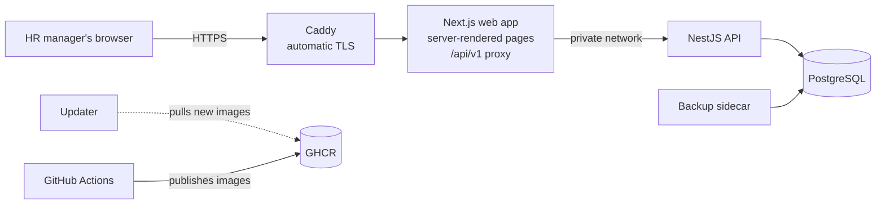
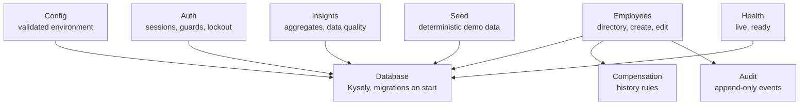
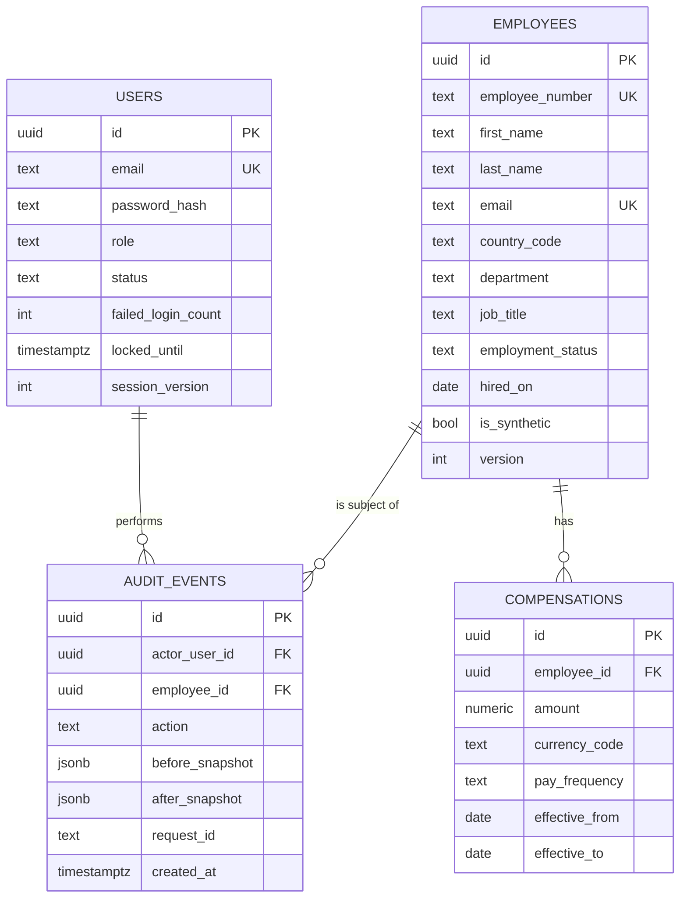

# Architecture

A modular monolith: one NestJS API, one Next.js web application, one PostgreSQL database. No message broker, no service mesh, no extra moving parts, because the problem (10,000 employees, one persona) does not need them.

## System



Only Caddy is exposed. The API and database are on a private network. The browser talks to one origin: pages are rendered on the server, and browser calls to `/api/v1/*` are forwarded by the web app to the API. This keeps cookies same-site, removes the need for cross-origin access, and lets one image run in any environment because the API address is read at runtime.

## Backend modules



| Layer            | Responsibility                                                                                                                        |
| ---------------- | ------------------------------------------------------------------------------------------------------------------------------------- |
| Controllers      | Routing, input validation through DTOs, role metadata. No business logic                                                              |
| Services         | Business rules: version checks, compensation planning, audit in the same transaction                                                  |
| Repositories     | All SQL, typed by Kysely. One shared definition of "current compensation"                                                             |
| Global behaviour | Auth, roles and origin guards; rate limiting; one exception filter and one response envelope; request ids; timeouts; security headers |

Shared types (response envelope, error codes, DTO shapes, domain constants) live in `packages/contracts` and are used by both applications, so the contract cannot drift.

## Data model



The database enforces the invariants that matter, so a bug in application code cannot corrupt them:

- `compensations`: amount greater than zero; `effective_to` after `effective_from`; an **exclusion constraint** forbids overlapping periods for one employee.
- `audit_events`: a trigger rejects every update and delete.
- `employees` and `users`: unique, lower-case emails; checked codes and lengths.

## One change, end to end

```mermaid
sequenceDiagram
    participant B as Browser
    participant W as Web (Next.js)
    participant A as API (NestJS)
    participant D as PostgreSQL
    B->>W: POST /api/v1/employees/:id/compensation
    W->>A: forwarded (size-capped, timed out)
    A->>A: rate limit, origin, session, role, validation
    A->>D: BEGIN; lock employee row
    A->>D: close open period, insert new period
    A->>D: insert audit event (before/after, request id)
    A->>D: COMMIT
    A-->>B: 201 in the success envelope
```

If anything fails, the transaction rolls back and the response uses the same error envelope (`code`, `message`, field `details`, `requestId`).

## Frontend

Server components fetch data with the user's cookie and render pages; forms are small client components. Generic building blocks keep the code short and typed: `useGenericState`, `useFormFields`, a typed `httpRequest` that unwraps the envelope, `useApiAction`, and generic `Mapping`, `DataTable` and `BarList` components.

## Deployment topology

`deploy/compose.prod.yaml` runs Caddy, web, API, PostgreSQL, the backup sidecar and the updater on one host. The application containers are read-only, run as an unprivileged user, drop all capabilities and are not published to the host. See [ci-cd.md](ci-cd.md) and [deployment.md](deployment.md).
