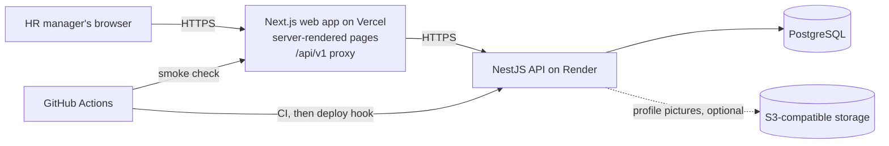
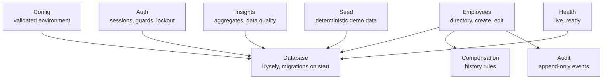
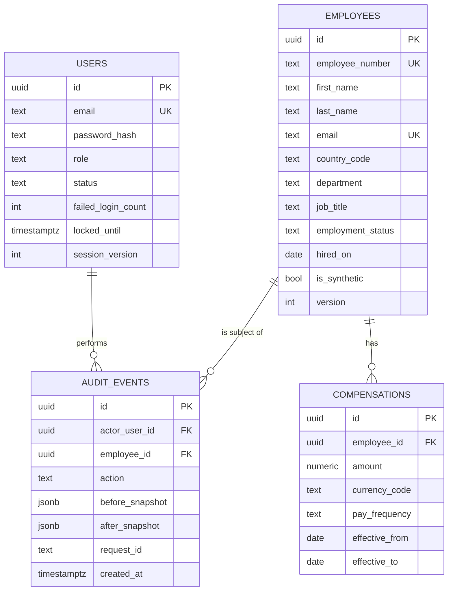

# Architecture

A modular monolith: one NestJS API, one Next.js web application, one PostgreSQL database. No message broker, no service mesh, no extra moving parts, because the problem (10,000 employees, one persona) does not need them.

## System



The browser talks to one origin: pages are rendered on the server, and browser calls to `/api/v1/*` are forwarded by the web app to the API. This keeps cookies same-site, removes the need for cross-origin access, and lets one build run in any environment because the API address (`API_ORIGIN`) is read at runtime.

## Backend modules



| Layer            | Responsibility                                                                                                                        |
| ---------------- | ------------------------------------------------------------------------------------------------------------------------------------- |
| Controllers      | Routing, input validation through DTOs, role metadata. No business logic                                                              |
| Services         | Business rules: version checks, compensation planning, audit in the same transaction                                                  |
| Repositories     | All SQL, typed by Kysely. One shared definition of "current compensation"                                                             |
| Global behaviour | Auth, roles and origin guards; rate limiting; one exception filter and one response envelope; request ids; timeouts; security headers |

Shared types (response envelope, error codes, DTO shapes, domain constants) live in `packages/contracts` and are used by both applications, so the contract cannot drift.

## Data model



The database enforces the invariants that matter, so a bug in application code cannot corrupt them:

- `compensations`: amount greater than zero; `effective_to` after `effective_from`; an **exclusion constraint** forbids overlapping periods for one employee.
- `audit_events`: a trigger rejects every update and delete.
- `employees` and `users`: unique, lower-case emails; checked codes and lengths.

## One change, end to end

```mermaid
sequenceDiagram
    participant B as Browser
    participant W as Web (Next.js)
    participant A as API (NestJS)
    participant D as PostgreSQL
    B->>W: POST /api/v1/employees/:id/compensation
    W->>A: forwarded (size-capped, timed out)
    A->>A: rate limit, origin, session, role, validation
    A->>D: BEGIN; lock employee row
    A->>D: close open period, insert new period
    A->>D: insert audit event (before/after, request id)
    A->>D: COMMIT
    A-->>B: 201 in the success envelope
```

If anything fails, the transaction rolls back and the response uses the same error envelope (`code`, `message`, field `details`, `requestId`).

## Frontend

Server components fetch data with the user's cookie and render pages; forms are small client components. Generic building blocks keep the code short and typed: `useGenericState`, `useFormFields`, a typed `httpRequest` that unwraps the envelope, `useApiAction`, and generic `Mapping`, `DataTable` and `BarList` components.

## Deployment

- **Web:** a Vercel project rooted at `apps/web`, redeployed by Vercel on every push to `master`.
- **API:** a Render web service built from `apps/api/Dockerfile`. CD calls its deploy hook after CI passes, then smoke-checks both apps. On Render's free plan the service sleeps when idle, so the first request after a pause is slow.
- **Local:** `docker-compose-infra.yml` runs PostgreSQL and RustFS; `docker-compose.yml` adds the API and web images.
- **Self-hosting (optional):** `deploy/` holds a Caddy, backup and restore setup for a single server. See [ci-cd.md](ci-cd.md).

The API migrates the database on every start, creates the first HR manager from `INITIAL_HR_EMAIL` and `INITIAL_HR_PASSWORD`, and seeds demo data only when none exists. Profile pictures are stored in S3-compatible storage and are switched off when no `S3_*` settings are given; the API reports this at `GET /features` so the UI hides the upload control.

## Decisions

| Decision                                                                                 | Why                                                                                              | Cost                                                                                                                         |
| ---------------------------------------------------------------------------------------- | ------------------------------------------------------------------------------------------------ | ---------------------------------------------------------------------------------------------------------------------------- |
| Modular monolith: one API, one web app, one database                                     | One persona and 10,000 employees do not justify microservices or a broker                        | Modules can be split later along their boundaries                                                                            |
| NestJS and Next.js, TypeScript end to end, shared `packages/contracts`                   | Guards, pipes and interceptors map to the cross-cutting needs; one language and one set of types |                                                                                                                              |
| Kysely, not a full ORM                                                                   | The important queries are aggregates, window functions and a shared "current compensation" join  | More explicit SQL, fully typed                                                                                               |
| Pay is grouped by currency and frequency, never converted                                | Any converted total would look authoritative and be wrong                                        | More dashboard rows, no false numbers                                                                                        |
| Compensation is a dated history, overlaps forbidden by an exclusion constraint           | History and audit come naturally                                                                 | Backdated corrections are future work                                                                                        |
| Append-only audit log enforced by a trigger, written in the same transaction             | The application cannot alter its own history                                                     |                                                                                                                              |
| Sessions: HttpOnly SameSite=Strict JWT with a per-user session version                   | Revocable without a session table; no tokens readable by scripts                                 | Signing out ends all of a user's sessions                                                                                    |
| Web app proxies the API at runtime                                                       | One build for every environment, one origin for the browser                                      | The proxy caps body size (2 MB for avatar uploads, 100 KB otherwise)                                                         |
| Migrations and seed run automatically on start                                           | An empty database becomes a working system with no manual step                                   | Migrations must stay backward compatible                                                                                     |
| Strict TypeScript 7 with type-aware oxlint (no `any`, assertions or non-null assertions) | typescript-eslint does not support TypeScript 7 yet                                              |                                                                                                                              |
| Offset pagination, live aggregates, no cache                                             | Measured at 10,000 rows, queries take tens of milliseconds ([performance.md](performance.md))    | Keyset pagination and caching are next if data grows by orders of magnitude                                                  |
| Full country and currency lists as plain data files (247 countries, 153 currencies)      | HR may hire anyone, anywhere; a short list would block the first unanticipated country           | A correction is a data edit and a release. The exchange rates only make synthetic salaries plausible; the app never converts |
| Profile pictures in optional S3 storage, keyed per employee                              | Keeps binary data out of PostgreSQL; the feature degrades cleanly when storage is absent         | Needs an S3-compatible service to turn on                                                                                    |
| Render for the API, Vercel for the web                                                   | Both free to start and deploy from Git                                                           | The free API sleeps when idle                                                                                                |
