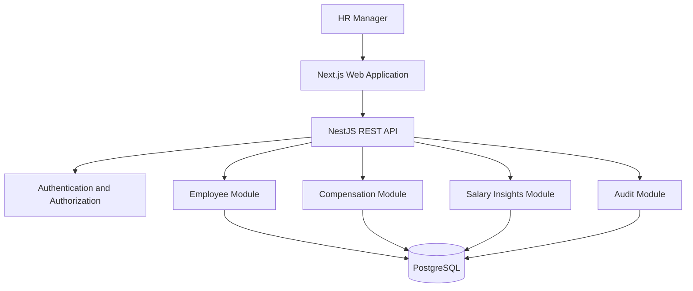
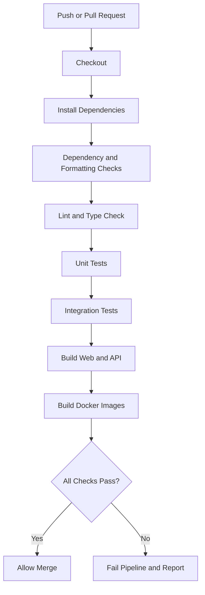
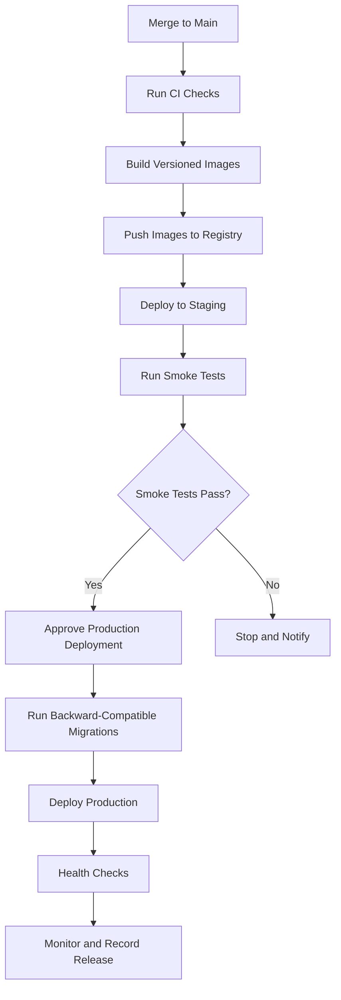

# ACME Salary Management Platform

## Engineering Approach, Product Requirements & Delivery Plan

**Assessment:** Incubyte — Software Craftsperson / Node / React / TypeScript II  
**Document type:** Requirements, solution design and execution plan  
**Status:** Proposed approach — implementation has not started

---

## 1. Product summary

Build a secure, web-based salary management platform that enables ACME's HR team to manage compensation records for 10,000 employees across multiple countries and answer operational questions about how the organisation pays its people.

The platform should replace spreadsheet-based salary administration with a reliable, auditable and searchable source of truth. The solution should demonstrate sound product judgement, maintainable engineering, meaningful tests, intentional AI-assisted development and a repeatable deployment process.

### Product outcome

An authorised HR manager can:

- Find and inspect an employee's current salary information.
- Create, update and manage employee compensation records.
- Understand salary distributions across countries, departments, job titles and currencies.
- Identify missing, inconsistent or unusual salary data.
- See who changed compensation information and when.
- Import the initial 10,000 employee records through a repeatable seed process.

### Guiding principles

1. **Correctness before cleverness:** compensation data must be accurate and changes must be traceable.
2. **Pragmatic architecture:** use a modular monolith, not microservices, for this assessment.
3. **Security by default:** salary information is sensitive business data.
4. **Useful product, not a CRUD demo:** prioritise workflows and questions an HR manager actually has.
5. **Observable and testable:** core business rules must be covered by deterministic tests.
6. **Operationally reproducible:** a reviewer should be able to run, test and deploy the system using documented steps.

---

## 2. One-page requirements document

### Goal

Give ACME's HR manager a secure and efficient way to manage employee salary data for a 10,000-person, multi-country organisation and obtain useful answers about compensation.

### Primary user

**HR Manager:** responsible for maintaining employee compensation information, reviewing salary distributions and investigating data quality.

The assessment will use a single HR-manager role. The design should leave room for more granular roles later without implementing an elaborate permissions system prematurely.

### In scope — minimum viable product

#### A. Employee and compensation management

- Display a searchable, paginated employee directory.
- View an employee's profile and current compensation details.
- Create an employee with the minimum required employment and compensation fields.
- Edit employee and salary details.
- Support employee status such as active and inactive.
- Validate required fields, numeric amounts, currency and effective dates.
- Prevent invalid or ambiguous compensation records.

#### B. Salary insights

Provide a dashboard and filterable summaries that answer questions such as:

- How many employees do we have?
- How many employees are in each country or department?
- What is the salary range within a selected country or department?
- What is the average and median salary for a selected group?
- How many employees are paid in each currency?
- Which employee records are missing required salary information?

**Currency rule:** do not add or average amounts from different currencies as if they were equivalent. Show figures grouped by currency unless a documented exchange-rate source and conversion policy are introduced in a future phase.

#### C. Search, filtering and navigation

- Search by employee name or employee identifier.
- Filter by country, department, job title, employment status and currency.
- Sort supported table columns.
- Keep filtering and pagination server-side.

#### D. Auditability

- Record salary creation and modification events.
- Store the actor, timestamp, affected employee, action and relevant before/after values.
- Make audit history available when inspecting an employee's compensation.
- Do not expose sensitive values unnecessarily in application logs.

#### E. Data seeding

- Provide a deterministic seed script that creates 10,000 realistic synthetic employees.
- Include multiple countries, departments, job titles, currencies and salary bands.
- Ensure repeatable execution does not create duplicate records.
- Clearly identify all generated records as synthetic.

### Deliberately out of scope

| Excluded feature                             | Reason                                                                                |
| -------------------------------------------- | ------------------------------------------------------------------------------------- |
| Payroll execution and payslip generation     | The brief asks for salary management, not payroll processing or payment integration.  |
| Tax, pension and statutory deductions        | These introduce country-specific legal rules beyond the assessment's core problem.    |
| Foreign-exchange conversion                  | Requires an exchange-rate provider, rate-date policy and financial accuracy controls. |
| Employee self-service portal                 | The stated persona is the HR manager.                                                 |
| Multiple approval workflows                  | Valuable in a larger HR product, but not necessary to demonstrate the core workflow.  |
| Recruitment, attendance and leave management | Outside salary administration.                                                        |
| Microservices and message brokers            | Unnecessary operational complexity for a single-user-focused assessment.              |
| Advanced BI and custom report builder        | A small set of reliable, useful salary insights is sufficient.                        |

### Success criteria

- A reviewer can start the application using documented instructions.
- The seeded database contains 10,000 employees.
- HR users can search, filter, paginate, inspect, create and update employee salary records.
- Dashboard calculations respect currency boundaries and filters.
- Salary changes create audit records.
- Validation and error states are understandable.
- Core business logic and API behaviour are covered by automated tests.
- CI runs quality checks and tests on every pull request.
- A deployed version and a short demonstration video are available.

---

## 3. Proposed architecture

### Architectural decision

Use a **modular monolith** with a separately deployable web application and API:

- Web application: Next.js with server-side rendering where appropriate.
- Backend: NestJS REST API.
- Database: PostgreSQL.
- Database access: a typed ORM or query layer with explicit migrations.
- Deployment: Docker containers.
- CI/CD: GitHub Actions.

The frontend and backend are separate applications, but the backend remains one deployable application with clear internal modules. This avoids the complexity of distributed transactions, service discovery and multiple deployments.

### High-level architecture



### Backend modules

| Module         | Responsibility                                                              |
| -------------- | --------------------------------------------------------------------------- |
| Authentication | Sign-in, session/token validation and identity context.                     |
| Users / Access | HR-manager access and authorization checks.                                 |
| Employees      | Employee identity, employment details, search and filtering.                |
| Compensation   | Salary records, validation, effective dates and current compensation rules. |
| Insights       | Aggregations and summaries used by the dashboard.                           |
| Audit          | Immutable records of salary-related changes.                                |
| Health         | Readiness and liveness endpoints for deployment checks.                     |

Modules should communicate through clear service interfaces. Avoid circular dependencies and avoid placing business logic in controllers.

### Frontend areas

- Dashboard
- Employee directory
- Employee detail
- Add/edit employee
- Compensation history
- Audit history
- Sign-in and access-denied states

Use server rendering for the initial page experience and server-side data loading where it improves first-load performance and access control. Use client components only where interaction requires them, such as editable forms, table controls and filters. SSR is a rendering strategy, not a reason to move business rules into the frontend.

### Data model — conceptual

**Employee**

- id
- employee_number (unique)
- first_name
- last_name
- email (unique where the business rule requires it)
- country_code
- department
- job_title
- employment_status
- created_at
- updated_at

**Compensation**

- id
- employee_id
- amount
- currency_code
- pay_frequency
- effective_from
- effective_to (nullable)
- created_at
- updated_at

**User**

- id
- email
- password_hash or external identity reference
- role
- status
- created_at

**AuditEvent**

- id
- actor_user_id
- employee_id
- action
- before_snapshot
- after_snapshot
- created_at
- request_id

The model should support compensation history rather than overwrite the only salary value. Define and enforce the rule for the current effective compensation record. Use database constraints for uniqueness and essential invariants.

Do not store calculated dashboard totals as primary employee data. Derive them from the source records unless measurement shows a genuine performance need.

---

## 4. API design outline

Use versioned REST endpoints, consistent response shapes, validation and appropriate HTTP status codes.

| Method | Endpoint                               | Purpose                                     |
| ------ | -------------------------------------- | ------------------------------------------- |
| POST   | `/api/v1/auth/login`                   | Authenticate HR manager                     |
| GET    | `/api/v1/employees`                    | Search, filter, sort and paginate employees |
| POST   | `/api/v1/employees`                    | Create employee and initial compensation    |
| GET    | `/api/v1/employees/:id`                | Retrieve employee details                   |
| PATCH  | `/api/v1/employees/:id`                | Update permitted employee details           |
| GET    | `/api/v1/employees/:id/compensation`   | Retrieve compensation history               |
| POST   | `/api/v1/employees/:id/compensation`   | Add a compensation record                   |
| GET    | `/api/v1/employees/:id/audit`          | Retrieve relevant audit history             |
| GET    | `/api/v1/insights/overview`            | Dashboard summary                           |
| GET    | `/api/v1/insights/salary-distribution` | Salary summaries by selected dimensions     |
| GET    | `/api/v1/health/live`                  | Liveness check                              |
| GET    | `/api/v1/health/ready`                 | Database/dependency readiness check         |

### API standards

- Validate request payloads at the API boundary.
- Use DTOs and explicit response models; do not return database entities blindly.
- Apply server-side pagination with a sensible default and maximum page size.
- Allowlist sortable fields to prevent unsafe query construction.
- Use consistent error responses with machine-readable codes.
- Document the API with OpenAPI/Swagger.
- Use transactions when a business operation writes both compensation and audit data.
- Make update semantics explicit; use optimistic concurrency or a version field if concurrent editing becomes a concern.

---

## 5. Data integrity, security and privacy

Salary records are sensitive. The assessment should demonstrate that this is understood, even if the application has only one role.

### Minimum security controls

- Require authentication for all business endpoints.
- Enforce authorization on the backend, not only by hiding frontend controls.
- Hash passwords with a recognised password-hashing algorithm if local credentials are implemented.
- Keep secrets in environment variables or deployment secrets, never in source control.
- Validate and normalise inputs.
- Use parameterised database access.
- Configure CORS narrowly for the deployed frontend origin.
- Apply secure cookie/session settings or a carefully implemented token strategy.
- Avoid logging passwords, tokens or full salary payloads.
- Use HTTPS in deployed environments.
- Provide a safe way to initialise the first HR manager; do not ship a public default password.
- Keep audit events append-only through application permissions and service design.

### Data handling decisions

- Seed only fictional employee data.
- Do not use real employee names, email addresses or compensation figures.
- Define currency as an ISO 4217 code.
- Store monetary values using a precise decimal representation, not floating-point arithmetic.
- Define pay frequency explicitly, for example annual, monthly or hourly.
- Keep country and currency separate; an employee's country does not always determine their pay currency.
- Define how effective dates and overlapping compensation periods are handled.

---

## 5A. Security hardening plan

### Threat → control matrix

| Threat                            | Control                                                                                                                                                                                                                                                                                                                                                                                                                                |
| --------------------------------- | -------------------------------------------------------------------------------------------------------------------------------------------------------------------------------------------------------------------------------------------------------------------------------------------------------------------------------------------------------------------------------------------------------------------------------------- |
| SQL injection                     | ORM/query builder with parameterised queries only; no string-concatenated SQL. Raw SQL (aggregations) uses bound parameters. Sort fields and filter keys come from allowlists/enums, never from request text. DB role has least privilege (no DDL at runtime, no write on audit rows beyond INSERT).                                                                                                                                   |
| Invalid / malicious input         | Strict DTO validation on every endpoint: `class-validator` + `class-transformer` with `ValidationPipe({ whitelist: true, forbidNonWhitelisted: true, transform: true })`. Unknown fields rejected. Every string has max length, every number a range, every enum a closed set, UUIDs/ISO currency/ISO country codes format-checked. Pagination `limit` capped. Mirror the same schemas on the frontend.                                |
| DoS / abuse                       | Global request rate limit (`@nestjs/throttler`, Redis-backed store in deployed env), stricter named limits on `/auth/login` and write endpoints. Body size limit (e.g. 100 KB JSON), request timeout, max page size, bounded query cost (no unbounded `LIKE '%x%'` on unindexed columns; trigram/prefix indexes), DB statement timeout and connection-pool cap, reverse-proxy limits (connections, header size, slow-client timeouts). |
| Brute force / credential stuffing | Per-IP and per-account login throttling, progressive lockout, argon2id hashing, uniform error for unknown user vs wrong password.                                                                                                                                                                                                                                                                                                      |
| XSS / clickjacking / sniffing     | `helmet`, strict CSP (no inline scripts), `HttpOnly` + `Secure` + `SameSite` cookies, React output escaping, no `dangerouslySetInnerHTML`.                                                                                                                                                                                                                                                                                             |
| CSRF                              | `SameSite=Lax/Strict` cookies plus same-origin check or CSRF token on state-changing requests.                                                                                                                                                                                                                                                                                                                                         |
| Broken access control             | Global auth guard (deny by default), `@Public()` opt-out, role guard, ownership checks in services, tests asserting 401/403 on every route.                                                                                                                                                                                                                                                                                            |
| Mass assignment                   | DTO whitelisting; response DTOs never expose entities or password hashes.                                                                                                                                                                                                                                                                                                                                                              |
| Sensitive data exposure           | Redacting logger (no passwords, tokens, salary payloads), TLS everywhere, secrets only in env/secret store.                                                                                                                                                                                                                                                                                                                            |
| Vulnerable dependencies           | `pnpm audit`, Dependabot, container image scan in CI, lockfile enforced.                                                                                                                                                                                                                                                                                                                                                               |
| Upload abuse                      | See section 5C.                                                                                                                                                                                                                                                                                                                                                                                                                        |

### Rate limiting policy

| Scope                                                       | Limit (starting values, tune by measurement)         |
| ----------------------------------------------------------- | ---------------------------------------------------- |
| Global, per IP                                              | 100 requests / minute                                |
| `POST /auth/login`, per IP + per account                    | 5 attempts / minute, lockout after repeated failures |
| Write endpoints (POST/PATCH/DELETE), per authenticated user | 30 / minute                                          |
| Insights/aggregation endpoints, per user                    | 30 / minute (heavier queries)                        |
| File upload, per user                                       | 10 / minute                                          |

Exceeded limits return `429` in the standard error envelope with a `Retry-After` header.

### Standard error envelope (401, 403, 429 and all other errors)

Every error from the API, including guard, validation and throttling failures, uses one shape through a single global exception filter. Stack traces and internal messages never reach the client.

```ts
type ApiErrorResponse = {
  success: false;
  error: {
    code: ErrorCode;
    message: string;
    details?: readonly FieldError[];
    requestId: string;
    timestamp: string;
  };
};

type FieldError = { field: string; message: string };
```

| HTTP | `code`                   | When                                                                                    |
| ---- | ------------------------ | --------------------------------------------------------------------------------------- |
| 400  | `VALIDATION_FAILED`      | DTO validation failed; `details` lists each field.                                      |
| 401  | `UNAUTHENTICATED`        | Missing, invalid or expired credentials.                                                |
| 403  | `FORBIDDEN`              | Authenticated but not permitted.                                                        |
| 404  | `NOT_FOUND`              | Resource missing (also used to avoid leaking existence where relevant).                 |
| 409  | `CONFLICT`               | Unique-constraint or version conflict.                                                  |
| 413  | `PAYLOAD_TOO_LARGE`      | Body or file over limit.                                                                |
| 415  | `UNSUPPORTED_MEDIA_TYPE` | Disallowed file type.                                                                   |
| 429  | `RATE_LIMITED`           | Throttle exceeded; includes `Retry-After`.                                              |
| 500  | `INTERNAL_ERROR`         | Unexpected; generic message, full detail only in server logs with the same `requestId`. |

Successful responses use a matching generic envelope:

```ts
type ApiSuccessResponse<T> = { success: true; data: T; meta?: PageMeta };
type PageMeta = { page: number; limit: number; total: number };
```

`ErrorCode` is a closed string-literal union shared by API and web so the frontend can switch on it exhaustively.

---

## 5B. Coding principles

1. **Strong typing everywhere:** `strict` TypeScript, no `any`, no unchecked `as` casts, no non-null `!`. Use `unknown` plus type guards at boundaries. Closed unions/enums instead of free strings. Branded types for IDs and money where it prevents mix-ups.
2. **Write once, use anywhere:** prefer generics over copy-paste. If the second use appears, extract it.
3. **No code comments.** Names, types and small functions carry the meaning. Only a rare, short "why" where the code cannot say it. Plan, task or phase references never appear in code.
4. **Small, single-purpose functions and modules;** no business logic in controllers or components.
5. **Validate at the boundary, trust types inside.**
6. **Errors are typed;** domain errors extend one base class and the global filter maps them to the envelope.
7. **Immutable data and pure functions** for business rules so they are trivially unit-testable.
8. **Money is decimal, never float.**

### Reusable generic building blocks

Mirrors the proven patterns from the sister project EduCloud Manager (`packages/web-utils`), adapted to REST + React.

**Frontend (`packages/web-utils` or `apps/web/src/lib`)**

| Block                                       | Purpose                                                                                                                                                      |
| ------------------------------------------- | ------------------------------------------------------------------------------------------------------------------------------------------------------------ |
| `useGenericState<T>(initial)`               | `useState` plus a key-patching setter and a whole-value setter, both referentially stable. Used instead of raw `useState` everywhere.                        |
| `useFormFields<T>(initial)`                 | One state object per form; `bind(key)` returns `{ value, onChange }` typed per field; `patch`, `reset`.                                                      |
| `httpRequest<TResponse, TBody>(config)`     | The single typed `fetch` wrapper: JSON in/out, unwraps `ApiSuccessResponse<T>`, throws `HttpRequestError` carrying `code`, `status`, `requestId`, `details`. |
| `useApiAction<TResponse, TBody>(url, opts)` | Mutation + pending flag + toast success/error, stable `run`.                                                                                                 |
| `useApiQuery<TResponse, TParams>`           | Typed GET with loading/error state and refetch.                                                                                                              |
| `useActionRunner`                           | Busy flag and toasts for arbitrary async actions.                                                                                                            |
| `<Mapping<T> />`                            | Render-prop list with `keyExtractor`, `empty` state; server-component safe.                                                                                  |
| `<DataTable<T> />`                          | Column-descriptor table (`columns`, `data`, `keyExtractor`, skeleton on `null`, `empty` state), server-component safe.                                       |
| `<PaginatedTable<T> />`                     | `DataTable` plus server-side pagination and sort controls driven by URL search params.                                                                       |
| `<FormField<T> />`, `<SelectField<T> />`    | Generic controlled inputs taking `{ value, onChange }` from `bind`.                                                                                          |
| `<FormDialog />`                            | Generic modal form shell.                                                                                                                                    |
| Chart primitives                            | Generic bar/donut/column charts fed by typed series.                                                                                                         |

**Backend (`apps/api/src/common`)**

| Block                                   | Purpose                                                                           |
| --------------------------------------- | --------------------------------------------------------------------------------- |
| `PaginatedQueryDto` and `paginate<T>()` | One pagination/sort contract and helper for every list endpoint.                  |
| `ApiSuccessResponse<T>` interceptor     | Wraps every response in the standard envelope.                                    |
| `AllExceptionsFilter`                   | Maps all exceptions to `ApiErrorResponse`.                                        |
| `BaseRepository<TEntity, TId>`          | Generic typed CRUD base; feature repositories add specific queries.               |
| `AuditInterceptor` / `@Audited()`       | Generic decorator that records before/after snapshots for any annotated mutation. |
| `StorageService` (interface)            | S3 abstraction, see 5C.                                                           |
| `Result<T, E>` type                     | Explicit success/failure return for domain logic.                                 |

---

## 5C. File and object storage (S3)

Used for employee profile pictures and supporting documents (for example contract letters).

- **Store objects in S3**, never in the database or on the app server disk. The database stores only the object key, content type, size, checksum and owner (`FileAsset` table).
- **Bucket is private.** Block all public access. Files are served through short-lived **pre-signed GET URLs** (for example 5 minutes), issued only after an authorisation check.
- **Uploads use pre-signed PUT/POST** (or a streamed upload through the API) with constraints: max size, allowed content types, key prefix fixed by the server.
- **Server-generated keys** such as `employees/{employeeId}/avatar/{uuid}.webp`. Never use the client's file name in the key. Original name is stored as metadata only after sanitising.
- **Strict validation:** allowlist of MIME types (`image/jpeg`, `image/png`, `image/webp`; `application/pdf` for documents), magic-byte sniffing rather than trusting the extension or header, size caps (for example 2 MB images, 10 MB documents), image re-encoding/resizing to strip metadata and neutralise payloads.
- **Security:** server-side encryption (SSE-S3 or KMS), versioning on, lifecycle rules for orphan cleanup, least-privilege IAM role scoped to one bucket/prefix, CORS limited to the web origin, rate-limited upload endpoint, optional antivirus scan hook.
- **Abstraction:** a `StorageService` interface (`put`, `getSignedUrl`, `delete`) with an S3 implementation (`@aws-sdk/client-s3`) and an in-memory fake for unit tests. Local development and CI use MinIO or LocalStack, so tests need no AWS account.
- **Audit:** upload and delete events are recorded like other changes.

Additional endpoints:

| Method | Endpoint                                 | Purpose                                                   |
| ------ | ---------------------------------------- | --------------------------------------------------------- |
| POST   | `/api/v1/employees/:id/avatar`           | Upload or replace profile picture (validated, re-encoded) |
| GET    | `/api/v1/employees/:id/avatar`           | Returns a short-lived signed URL                          |
| DELETE | `/api/v1/employees/:id/avatar`           | Remove profile picture                                    |
| POST   | `/api/v1/employees/:id/documents`        | Upload supporting document                                |
| GET    | `/api/v1/employees/:id/documents/:docId` | Signed download URL                                       |

---

## 6. Performance and scale considerations

The stated dataset is 10,000 employees. This is comfortably manageable with a conventional relational database and a well-designed application. Avoid claiming that the system needs distributed architecture merely because the employee count is 10,000.

### Required practices

- Server-side pagination; never load all 10,000 records into the browser.
- Add indexes for employee number, searchable identity fields and commonly filtered fields.
- Index foreign keys and frequently used compensation lookup fields.
- Use database aggregation for dashboard summaries.
- Select only the columns required by each view.
- Avoid N+1 queries.
- Keep API responses bounded.
- Use query plans to inspect slow or unexpected database queries.
- Use deterministic seed data so performance comparisons are repeatable.

### Performance verification

Measure representative operations:

1. Load the first employee-directory page.
2. Search by employee number and name.
3. Filter by country, department and currency.
4. Load one employee's compensation history.
5. Load dashboard aggregates.
6. Seed 10,000 employees from a clean database.

Record dataset size, environment, query duration and method. Do not invent performance claims; report measured results from the deployed or local test environment.

---

## 7. Testing strategy

Tests should verify behaviour and business rules, not merely line coverage.

### Unit tests

- Compensation amount and currency validation.
- Effective-date validation and current-record selection.
- Employee creation and update rules.
- Salary aggregation grouped by currency.
- Audit event creation.
- Authorization decisions.

### Integration tests

- Employee and compensation persistence.
- Transactional creation of compensation and audit events.
- Search, filters, sorting and pagination against a real test database.
- Dashboard aggregates against known fixtures.
- Invalid requests and database constraint handling.

### End-to-end tests

Cover the primary HR workflow:

1. Sign in as the HR manager.
2. Open the dashboard.
3. Search for an employee.
4. Open the employee profile.
5. Add or update compensation.
6. Verify the new compensation and audit history.
7. Filter the employee directory and verify the result.

### Test quality rules

- Tests must be deterministic and isolated.
- Use controlled fixtures and a dedicated test database.
- Do not depend on production services or external network calls.
- Test edge cases such as empty results, invalid currency, duplicate employee number, invalid date ranges and mixed-currency summaries.
- Keep tests readable and focused.
- Run the same essential checks locally and in CI.

---

## 8. CI/CD plan

### CI — pull request and branch validation

Use GitHub Actions to run the following pipeline:



**CI tasks**

- Install dependencies using the committed lockfile.
- Run formatting verification.
- Run linting.
- Run TypeScript type checks.
- Run backend unit tests.
- Run integration tests using a disposable PostgreSQL service/container.
- Run frontend tests.
- Build the Next.js application.
- Build the NestJS application.
- Build Docker images.
- Run dependency audit (`pnpm audit`), secret scanning and container image vulnerability scans; fail on high severity.
- Run security tests: 401/403 on every protected route, rate-limit 429 behaviour, validation rejection of unknown and oversized fields, injection payloads against search and sort parameters.
- Enforce strict TypeScript with `no-explicit-any` and a no-comments lint rule.
- Publish test results and useful build artifacts.

Do not deploy from untrusted pull requests. Keep CI permissions minimal.

### CD — deployment after merge



**CD tasks**

- Build immutable images tagged with the Git commit SHA and release version.
- Push images to a container registry.
- Deploy the same image artifact to staging and production.
- Inject environment-specific configuration through deployment secrets.
- Run database migrations as a controlled release step.
- Run post-deployment health and smoke checks.
- Retain the previous known-good image for rollback.
- Document how to restore the database from backup.
- Require an approval gate before production deployment if the environment supports it.

For an assessment deployment, a small VPS or managed container platform is sufficient. Do not add Kubernetes solely to make the project look enterprise-grade. Docker Compose can be enough for a single-host deployment, provided secrets, backups, TLS and restart behaviour are handled properly.

### Operational essentials

- HTTPS and domain configuration.
- Persistent database storage.
- Automated database backups and a documented restore procedure.
- Application and reverse-proxy logs.
- Health checks and restart policies.
- Environment separation for local, test, staging and production.
- No secrets committed to Git.

---

## 9. AI-assisted engineering workflow

The assessment explicitly requires AI usage. Use AI as an engineering assistant, not as an unquestioned code generator.

### Working method

1. **Plan first:** create the requirements, architecture, domain rules and implementation checklist before generating application code.
2. **Work in small slices:** implement one vertical workflow at a time.
3. **Use bounded prompts:** give the AI the relevant module, constraints, expected behaviour and test requirements.
4. **Review generated code:** inspect correctness, security, naming, complexity and consistency with existing patterns.
5. **Test every meaningful change:** run targeted tests before accepting generated changes.
6. **Verify claims:** independently check framework APIs, library behaviour, database migrations and security recommendations.
7. **Record useful prompts:** commit a concise prompt log or representative prompts, excluding secrets and private data.
8. **Keep ownership:** be able to explain every significant design decision and line of critical business logic.

### Example prompt record

For each substantial AI-assisted task, record:

- Problem being solved.
- Relevant architectural constraints.
- Prompt or instruction supplied.
- Files or modules affected.
- Tests run.
- Human review or corrections made.
- Final decision and trade-offs.

Do not commit raw conversation dumps if they contain irrelevant material, credentials or sensitive data. A curated `docs/ai-workflow.md` is more useful.

---

## 10. Incremental Git history

The brief explicitly asks for incremental commits. Commit coherent, working changes rather than one large final snapshot.

Suggested sequence:

1. `docs: add product requirements and scope`
2. `docs: define architecture and domain model`
3. `chore: initialise workspace and development tooling`
4. `feat(api): add application health endpoints`
5. `feat(api): add authentication and HR access control`
6. `feat(api): implement employee management`
7. `feat(api): implement compensation history and validation`
8. `feat(api): record compensation audit events`
9. `feat(api): add salary insights and aggregation`
10. `feat(web): add HR dashboard`
11. `feat(web): add employee directory and search`
12. `feat(web): add employee and compensation workflows`
13. `test: cover core business rules and API workflows`
14. `seed: add deterministic 10000 employee dataset`
15. `ci: add automated quality and test pipeline`
16. `build: add production container images`
17. `deploy: add staging and production workflow`
18. `docs: add setup, deployment and demo instructions`

These are proposed milestones, not commits to create before the corresponding work exists. Keep commits small enough to explain and ensure each commit builds where practical.

---

## 11. Repository structure proposal

A simple monorepo keeps the two applications and shared documentation together.

```text
acme-salary-management/
├── apps/
│   ├── api/                 # NestJS application
│   └── web/                 # Next.js application
├── packages/
│   ├── contracts/           # Shared envelope, ErrorCode, DTO types (single source of truth)
│   └── web-utils/           # Generic hooks and components (useGenericState, DataTable, Mapping, httpRequest)
├── database/
│   ├── migrations/
│   └── seeds/
├── docs/
│   ├── requirements.md
│   ├── architecture.md
│   ├── decisions.md
│   ├── ai-workflow.md
│   ├── performance.md
│   └── deployment.md
├── infrastructure/
│   ├── docker/
│   └── deployment/
├── .github/
│   └── workflows/
├── compose.yaml
├── .env.example
├── README.md
└── package.json
```

The shared `contracts` package is justified because the error envelope, `ErrorCode` union and request/response types must stay identical between API and web.

---

## 12. Delivery phases and definition of done

### Phase 1 — Understand and design

- Finalise requirements and exclusions.
- Define compensation and currency rules.
- Agree the conceptual data model and API boundaries.
- Record important architectural decisions.

**Exit condition:** the product scope and core domain rules are clear before implementation.

### Phase 2 — Establish the foundation

- Create the repository and application skeletons.
- Configure environment management, database migrations and local development.
- Add health endpoints and a reproducible startup process.
- Establish linting, formatting and test commands.

**Exit condition:** a new developer can start the system using the README.

### Phase 3 — Implement the core workflow

- Authentication and HR access.
- Employee directory, search, filters and pagination.
- Employee detail and compensation history.
- Create/update compensation with validation.
- Audit trail.

**Exit condition:** the complete employee salary-management workflow works end to end.

### Phase 4 — Insights and realistic data

- Dashboard summaries.
- Currency-safe salary distributions.
- Deterministic 10,000-employee seed.
- Verify filters and summaries against known fixtures.

**Exit condition:** the HR manager can answer the core questions in the requirements.

### Phase 5 — Quality and performance

- Unit, integration and end-to-end tests.
- Security review.
- Database index and query review.
- Test the seeded dataset and record measured results.

**Exit condition:** core behaviour is covered and no known critical correctness or security issue remains.

### Phase 6 — Delivery

- Dockerise applications.
- Implement CI and CD.
- Deploy the application.
- Verify health checks, persistence and backups.
- Record a concise demonstration video.
- Complete documentation and final repository review.

**Exit condition:** a reviewer can access the deployed application, understand the design and reproduce the system.

---

## 13. Demonstration video outline

Aim for a short, focused demonstration of approximately 4–6 minutes.

1. Introduce the problem and the product's scope.
2. Sign in as the HR manager.
3. Show the dashboard and explain currency-aware summaries.
4. Search and filter the 10,000-employee directory.
5. Open an employee profile and inspect compensation history.
6. Update compensation and show the resulting audit event.
7. Show validation by attempting an invalid change.
8. Briefly show the repository structure, automated tests and CI pipeline.
9. Show the deployed application and explain the deployment approach.

Demonstrate real behaviour. Do not present mocked dashboard numbers as live database results.

---

## 14. Risks and decisions to make explicit

| Risk / decision       | Approach                                                                                |
| --------------------- | --------------------------------------------------------------------------------------- |
| Different currencies  | Group salary metrics by currency; never silently combine unlike currencies.             |
| Salary history        | Preserve effective-dated compensation records instead of overwriting history.           |
| Concurrent edits      | Use transactions and consider optimistic concurrency for conflicting updates.           |
| Sensitive salary data | Authenticate, authorise, minimise logs and use HTTPS.                                   |
| Large table responses | Server-side pagination, filtering and sorting.                                          |
| Seed repeatability    | Deterministic data and idempotent or reset-safe seed procedure.                         |
| Deployment complexity | Start with Docker Compose or a small managed platform; avoid unnecessary orchestration. |
| AI-generated defects  | Human review, targeted tests and verification of framework/library behaviour.           |
| Scope expansion       | Keep payroll, tax, approvals and FX conversion out of the MVP.                          |

### Architecture decision records

Create short records for decisions that materially affect the design, for example:

- Why a modular monolith instead of microservices.
- Why compensation history is modelled separately from employee identity.
- Why salary summaries are grouped by currency.
- Why Next.js uses SSR selectively.
- Why the deployment target does not require Kubernetes.

Each record should include context, decision, alternatives considered and consequences.

---

## 15. Final submission checklist

### Product

- [ ] Requirements document committed.
- [ ] Scope and exclusions are explicit.
- [ ] HR manager can complete the core workflow.
- [ ] Dashboard answers meaningful salary questions.
- [ ] 10,000 synthetic employees can be seeded.

### Engineering

- [ ] Backend and frontend are independently understandable.
- [ ] Database migrations are committed.
- [ ] Validation and error handling are consistent.
- [ ] Salary history and audit trail work.
- [ ] Currency-sensitive calculations are correct.
- [ ] No unnecessary microservices or infrastructure.

### Quality

- [ ] Unit tests cover business rules.
- [ ] Integration tests cover persistence and API behaviour.
- [ ] End-to-end tests cover the main HR workflow.
- [ ] Lint, type checks and production builds pass.
- [ ] Security-sensitive paths have been reviewed.

### Delivery

- [ ] CI workflow runs on pull requests.
- [ ] CD workflow deploys a versioned artifact.
- [ ] Application is deployed and accessible.
- [ ] Database persistence and backup approach are documented.
- [ ] Demo video is available.
- [ ] README contains setup, test, seed and deployment instructions.
- [ ] Commit history shows incremental development.
- [ ] AI workflow and important design decisions are documented.

---

## 16. What “best” means for this assessment

The strongest submission is not the one with the largest number of technologies. It is the one that solves the stated HR problem completely, handles salary data responsibly, explains its trade-offs and can be run and reviewed without guesswork.

Prioritise, in this order:

1. Correct employee and compensation workflows.
2. Data integrity, currency correctness and auditability.
3. Clear architecture and maintainable code.
4. Meaningful automated tests.
5. A useful, polished HR interface.
6. Reproducible CI/CD and deployment.
7. Evidence of thoughtful AI-assisted engineering.

**Do not build a distributed enterprise platform for a 10,000-row assessment dataset. Build a small, production-minded system that demonstrates enterprise-quality decisions.**
